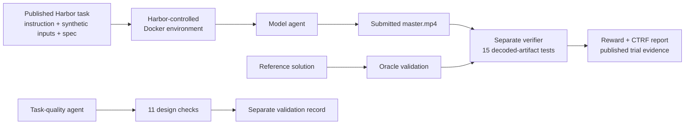

# Methodology

## Evaluation question

Can an agent diagnose mixed picture, audio, timing, and metadata defects, then produce a genuinely conformant 60-second broadcast master from a specification and cut list?

The task intentionally withholds a defect inventory. The instruction tells the agent to measure decoded media rather than trust tags. Seven owner-generated synthetic sources exercise variable frame rate, rotation, anamorphic geometry, true and mistagged color interpretation, sync slip, clock drift, mixed sample rates, and inconsistent loudness.

## Evidence flow

The model sees the instruction, delivery specification, timeline, and source footage. It does not receive the reference solution, hidden ground truth, authoring-time input hashes, or verifier implementation. The verifier runs separately after agent execution.

## Primary comparison set

The primary comparison contains 20 trials: five on each of four recorded routes. Each trial starts from the same published task package and is scored by the same 15 tests. A trial passes only when all tests pass and the verifier reward is `1`.

The four routes were:

- `openai/gpt-6-astra`
- `openrouter/qwen/qwen3.8-max-0902`
- `openrouter/moonshotai/kimi-k3`
- `openrouter/deepseek/deepseek-v4-pro`

The public IDs in [`results/trial-summary.csv`](results/trial-summary.csv) replace random local trial slugs. They do not change scores, timestamps, usage, costs, failed-test names, or output hashes.

## What the verifier measures

The 15 tests cover:

1. deliverable presence;
2. byte-identical inputs;
3. container and stream properties;
4. constant frame rate and duration;
5. keyframe interval;
6. decoded limited-range levels;
7. decoded patch colorimetry;
8. segment identity and cut placement;
9. required padding and edge behavior;
10. A/V sync;
11. absence of synthesized blend frames;
12. beep spacing and residual drift;
13. segment audio provenance;
14. program loudness and true peak; and
15. segment loudness.

The executable definitions live in [`task/tests/test_outputs.py`](task/tests/test_outputs.py) and [`task/tests/qc_lib.py`](task/tests/qc_lib.py). The public task keeps the answer-bearing verifier files separate from the agent environment, matching Harbor's task model.

## Validation lanes

Validation is reported separately from model performance:

- **Oracle:** the reference solution earned reward `1` and passed 15/15 verifier tests.
- **Completed task-quality check:** an OpenCode check agent passed all 11 design criteria.
- **Authentication-aborted check:** an earlier Claude Code check attempt stopped because the runner was not logged in. It consumed no model tokens, did not evaluate the task, and is not a failed quality check.

See [`trials/validation/README.md`](trials/validation/README.md) and [`trials/validation/validation-summary.json`](trials/validation/validation-summary.json).

## Reproducing the evaluation

1. Install a current Harbor release and a compatible container runtime.
2. Copy [`task/`](task/) to a clean location.
3. Verify the task files with `sha256sum -c CHECKSUMS.sha256` from inside that directory.
4. Configure a reviewer-owned model route and credentials.
5. Run the Oracle and any task-quality checks as validation, separately from model trials.
6. Run the chosen model route against the unchanged task.
7. Record the Harbor version, route, provider, settings, date, reward, verifier report, usage, cost, runtime, and any deviation.
8. Compare the new report with [`results/trial-summary.csv`](results/trial-summary.csv) and the retained verifier reports.

Exact outputs are not expected from hosted generative systems. The reproducible object is the evaluation procedure and evidence structure.
