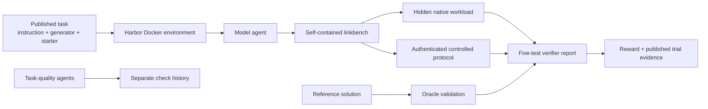

# Methodology

## Evaluation question

Can an agent produce a self-contained linker benchmark whose timing and identity evidence remains valid under adversarial but legitimate process behavior?

The visible workload is a deterministic synthetic C link graph generated at image-build time. The agent receives an incomplete starter harness, format documentation, and a diagnostic lab. It must repair `/app/linkbench`, follow a fixed 24-link schedule, and emit an exact JSON report.

## Evidence flow

## Primary comparison

The balanced set contains 15 trials: five on each of three recorded routes. Every trial lock recorded:

- task digest `sha256:44a28ec01f8faecf4bb0a706e1b841fb6f2ffcb33daeaa1d3d416a1db09e9763`;
- OpenCode `1.19.0`;
- Docker execution;
- `resume_trajectory: false`; and
- a separate verifier environment.

A trial passes only when all five verifier tests pass and the reward is `1`.

## Five verifier layers

1. **Artifact form:** `/app/linkbench` must be one executable regular file, self-contained and no larger than one MiB.
2. **Ordinary-user tracing:** the artifact must work without privileged execution in the stated Python and `strace` environment.
3. **Hidden native workload:** real BFD, gold, LLD, and mold executions test schema, output correctness, plausible timing, medians, and ranking.
4. **Authenticated controlled protocol:** signed observer evidence tests exact schedule, process identity, verbatim paths, family changes, thread controls, version probes, fresh outputs, timing, and failure cleanup.
5. **Reward-channel hygiene:** daemonized or otherwise untrusted work cannot survive to manipulate grading.

The controlled tools share dispatcher entry points and include decoys, a post-link helper, non-normalized paths, a wrong-family alias, and a late same-path family change. These cases force the harness to attribute the process that performed each link rather than trust selector names or simple exec order.

## Exploratory and validation boundaries

One Qwen3.7 Plus trial and one earlier DeepSeek V4 Pro trial used the same historical task digest but do not form balanced route sets. They remain exploratory.

Oracle and task-quality checks answer different questions and are never included in model pass rates. The original Oracle is reconstructed from a contemporaneous development record because its temporary job directory was not retained. A fresh Oracle run against the sanitized public task supplies direct reproducibility evidence.

## Reproduction

1. Install a current Harbor release and compatible Docker runtime on an x86-64 Linux host.
2. Copy [`task/`](task/) to a clean directory and verify [`task/CHECKSUMS.sha256`](task/CHECKSUMS.sha256).
3. Run the Oracle independently to confirm the reference solution and verifier.
4. Configure a reviewer-owned model route, provider credentials, and OpenCode-compatible Harbor agent.
5. Run the unchanged task and retain the submitted `linkbench`, CTRF report, route, Harbor/OpenCode versions, settings, usage, cost, and timing.
6. Compare the new evidence with [`results/trial-summary.csv`](results/trial-summary.csv) and the published artifacts.

Exact timings and generated code may vary. Reproduction means repeating the controlled procedure and making configuration differences visible.
